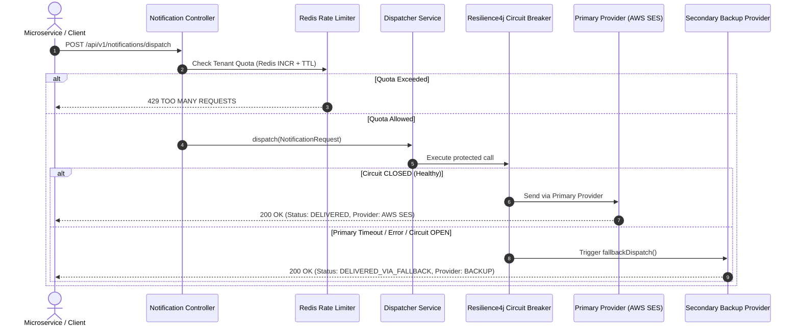

<div align="center">

# 🔔 Resilient Notification Hub

**A high-availability, multi-channel notification engine engineered with Java 21, Spring Boot 3, Redis Token Bucket rate limiting, and Resilience4j circuit breakers.**

[](https://openjdk.org/)
[](https://spring.io/projects/spring-boot)
[](https://resilience4j.readme.io/)
[](https://redis.io/)
[](https://www.docker.com/)

</div>

---

## 📌 Executive Overview

In production microservice architectures, external notification providers (AWS SES, Twilio, SendGrid) frequently experience transient latency spikes and rate exhaustion.

**Resilient Notification Hub** provides an enterprise abstraction layer that guarantees message delivery while protecting upstream systems:
- **Tenant-Level Rate Limiting:** Enforces strict quotas (60 req/min per tenant) via distributed Redis atomic counters.
- **Circuit Breaker Failover:** Detects degraded primary provider performance using Resilience4j and seamlessly routes traffic to hot backup providers.
- **Multi-Channel Dispatch:** Uniform API contracts for Email, SMS, Push, and Event Webhooks.

---

## 🏗️ Architecture & Failover Lifecycle



---

## 🛡️ Reliability Guarantees

1. **Sliding Window Rate Limiter:** Protects provider credit exhaustion by maintaining distributed counters in Redis per tenant ID.
2. **Circuit State Management:** Automatically trips from `CLOSED` to `OPEN` when the failure rate exceeds 50% across a 10-call sliding window, protecting latency.
3. **Automated Half-Open Probing:** Safely samples downstream health before restoring full traffic to primary integrations.

---

## 🚀 Quickstart Guide

### Prerequisites
- [Docker](https://www.docker.com/) & Docker Compose
- [Java 21 JDK](https://adoptium.net/) & [Maven 3.9+](https://maven.apache.org/)

### 1. Launch Redis and Application Stack
```bash
docker compose up -d
```

### 2. Or Run Locally via Maven
Ensure a local Redis instance is running on port 6379, then execute:
```bash
mvn spring-boot:run
```
The service will start on port **`8082`**.

---

## 🧪 Testing Notification Dispatch

### Dispatch a Multi-Channel Notification
```bash
curl -X POST http://localhost:8082/api/v1/notifications/dispatch \
  -H "Content-Type: application/json" \
  -d '{
    "tenantId": "tenant_enterprise_wehandle",
    "channel": "EMAIL",
    "recipient": "security-alerts@client.com",
    "subject": "Critical Security Alert: Access Revoked",
    "body": "System detected an unauthorized credential request from IP 192.168.1.104.",
    "priority": "HIGH"
  }'
```

**Response Payload (HTTP 200 OK):**
```json
{
  "notificationId": "ntf_3a91b2c4",
  "tenantId": "tenant_enterprise_wehandle",
  "channel": "EMAIL",
  "recipient": "security-alerts@client.com",
  "status": "DELIVERED",
  "providerUsed": "PRIMARY_PROVIDER_AWS_SES",
  "fallbackTriggered": false,
  "dispatchedAt": "2026-11-10T03:45:00Z"
}
```

---

## 📊 Documentation & Health Metrics

- **OpenAPI / Swagger UI:** `http://localhost:8082/swagger-ui.html`
- **Circuit Breaker Actuator Status:** `http://localhost:8082/actuator/health`

---

## 📄 License

This project is licensed under the [MIT License](LICENSE).
